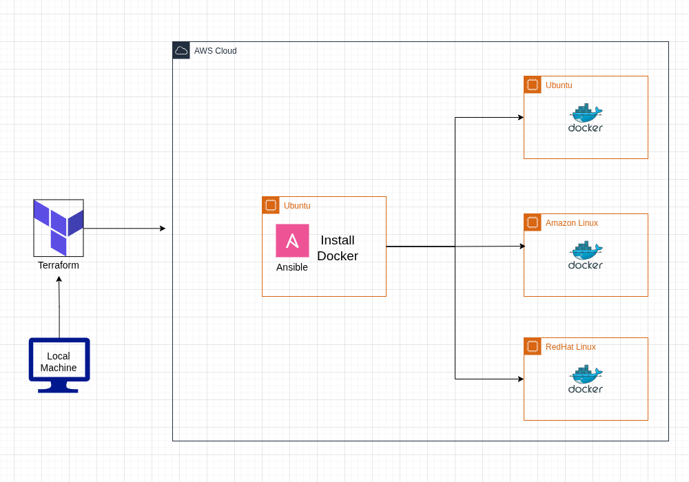

# tf-ansible-automation

A collection of infrastructure automation projects combining **Terraform** and **Ansible** — each project provisions cloud resources and configures them end-to-end.

## Projects

| Project Diagram | Project | Description |
|---|---|---|
| | [cross-os-docker-installation](./cross-os-docker-installation) | Provision an AWS VPC stack with Terraform and install Docker across Amazon Linux, RHEL, and Ubuntu using an Ansible role. |
| | [cross-os-nginx-app](./cross-os-nginx-app) | Provision an AWS VPC stack with Terraform and install Nginx across Amazon Linux, RHEL, and Ubuntu using an Ansible role. With deploying a index.html to the nginx |

---

*More projects coming soon.*