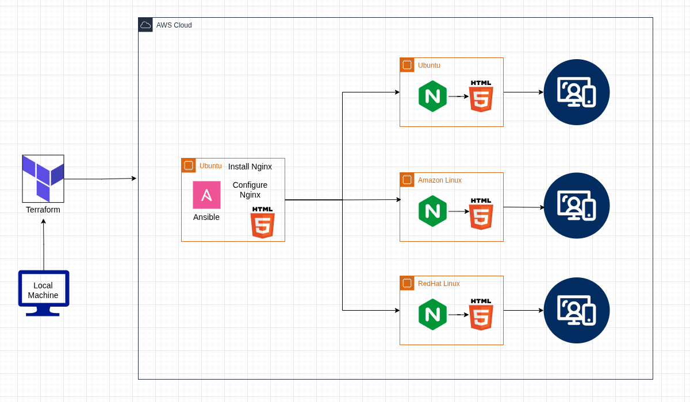

# 🌐 Cross-OS Nginx App

> **Automated Nginx deployment and configuration across Amazon Linux, RHEL, and Ubuntu — powered by Terraform and Ansible.**

Provision a full AWS VPC stack with Terraform, auto-generate your Ansible inventory, and install and configure Nginx across multiple Linux distributions using a single, OS-aware Ansible role. Each host serves a custom `index.html` page out of the box.

---

## 📑 Table of Contents

- [Overview](#-overview)
- [Architecture](#-architecture)
- [Repository Structure](#-repository-structure)
- [Terraform Layer](#-terraform-layer)
- [Ansible Role](#-ansible-role)
- [End-to-End Workflow](#-end-to-end-workflow)
- [Variables Reference](#-variables-reference)
- [Quick Start](#-quick-start)
- [Notes & Best Practices](#-notes--best-practices)

---

## 🔭 Overview

This project automates the entire lifecycle — from cloud infrastructure to a running, configured web server — in two clean phases:

| Phase | Tool | What It Does |
|---|---|---|
| **Provisioning** | Terraform | Creates VPC, subnets, gateways, security groups, and EC2 instances |
| **Configuration** | Ansible | Detects OS family, installs Nginx, deploys `index.html`, enables the service |

The two phases are connected by a **dynamically generated `inventory.ini`** — Terraform writes it automatically after provisioning, so Ansible always has the correct host IPs without any manual intervention.

---

## 🏗️ Architecture

### Architecture Diagram


### Pipeline Overview

```
┌─────────────────────────────┐
│       Terraform Apply       │
└──────────────┬──────────────┘
               │ provisions
               ▼
┌──────────────────────────────────────────────────┐
│  AWS Infrastructure                              │
│                                                  │
│  VPC → Subnets (public + private)                │
│      → Internet Gateway                          │
│      → NAT Gateway                               │
│      → Route Tables                              │
│      → Security Groups                           │
│      → EC2 Instances                             │
└──────────────┬───────────────────────────────────┘
               │ generates
               ▼
┌────────────────────────────────┐
│  inventory.tpl → inventory.ini │
└──────────────┬─────────────────┘
               │ consumed by
               ▼
┌─────────────────────────────┐
│     Ansible playbook.yml    │
│        (nginx role)         │
└──────┬──────────────────────┘
       │ branches by OS family
       ├──────────────────────────► Amazon Linux tasks
       ├──────────────────────────► RHEL / CentOS tasks
       └──────────────────────────► Ubuntu / Debian tasks
               │
               ▼
       🌐 Nginx installed, index.html deployed & service running on all hosts
```

### Network Topology

```
                        Internet
                           │
                    ┌──────▼───────────┐
                    │   IGW (Internet  │
                    │   Gateway)       │
                    └──────┬───────────┘
                           │
              ┌────────────▼─────────────┐
              │        VPC               │
              │                          │
              │  ┌─────────────────┐     │
              │  │  Public Subnet  │     │
              │  │                 │     │
              │  │  ┌───────────┐  │     │
              │  │  │ Public EC2│  │     │
              │  │  │ (Bastion) │  │     │
              │  │  └───────────┘  │     │
              │  │  ┌───────────┐  │     │
              │  │  │NAT Gateway│  │     │
              │  │  └─────┬─────┘  │     │
              │  └────────│────────┘     │
              │           │ outbound     │
              │  ┌────────▼────────┐     │
              │  │ Private Subnet  │     │
              │  │  (optional)     │     │
              │  │                 │     │
              │  │  ┌───────────┐  │     │
              │  │  │Private EC2│  │     │
              │  │  │(Workload) │  │     │
              │  │  └───────────┘  │     │
              │  └─────────────────┘     │
              └──────────────────────────┘
```

| Component | Subnet | Internet Access | Role |
|---|---|---|---|
| Public EC2 | Public | Direct via IGW | Bastion / Web Server |
| Private EC2 | Private | Outbound only via NAT | Application Server (optional) |
| Internet Gateway | VPC-level | — | Public subnet ingress/egress |
| NAT Gateway | Public Subnet | — | Private subnet outbound only |

---

## 📁 Repository Structure

```
.
├── ansible/
│   ├── index.html                     # Custom Nginx landing page (deployed to all hosts)
│   ├── inventory.ini                  # Auto-generated by Terraform
│   ├── playbook.yml                   # Ansible entry point
│   └── roles/
│       └── nginx/
│           ├── defaults/
│           │   └── main.yml           # nginx_port: 80, nginx_enabled: true
│           ├── files/                 # Static files (if any)
│           ├── handlers/
│           │   └── main.yml           # Restart & Enable Nginx handlers
│           ├── meta/
│           │   └── main.yml           # Role metadata & dependencies
│           ├── README.md              # Role-level documentation
│           ├── tasks/
│           │   ├── main.yml           # OS detection & task dispatcher
│           │   ├── amazon_spec_tasks.yml  # Amazon Linux 2 / 2023
│           │   ├── redhat_spec_tasks.yml  # RHEL / CentOS Stream
│           │   └── ubuntu_spec_tasks.yml  # Ubuntu / Debian
│           ├── templates/             # Jinja2 templates (if any)
│           ├── tests/
│           │   ├── inventory
│           │   └── test.yml
│           └── vars/
│               └── main.yml           # Role-scoped variable overrides
│
├── diagrams/
│   └── cross-os-nginx-app.png
│
├── README.md                          # ← You are here
│
└── terraform/
    ├── backend.tf                     # Remote state config (S3)
    ├── inventory-generator.tf         # Renders inventory.ini from template
    ├── main.tf                        # Root module — wires all modules
    ├── outputs.tf                     # Root-level outputs
    ├── provider.tf                    # AWS provider & region
    ├── README.md                      # Terraform-layer documentation
    ├── variables.tf                   # Root-level input variables
    ├── modules/
    │   ├── ec2/
    │   ├── internet-gtw/
    │   ├── nat-gtw/
    │   ├── route-tables/
    │   ├── sg/
    │   ├── subnets/
    │   └── vpc/
    └── templates/
        └── inventory.tpl              # Ansible inventory template
```

---

## 🏛️ Terraform Layer

See [`terraform/README.md`](./terraform/README.md) for a full breakdown of every module, the dynamic inventory generator, and all input variables.

**In brief:** Terraform provisions a complete AWS VPC stack and writes `ansible/inventory.ini` automatically after `apply` — there is nothing to copy or paste.

---

## ⚙️ Ansible Role

See [`ansible/roles/nginx/README.md`](./ansible/roles/nginx/README.md) for the full role reference, OS-specific task details, and handler behaviour.

**In brief:** The `nginx` role detects the OS family at runtime, installs Nginx via the correct package manager, copies `index.html` to the web root, and ensures the service is running and enabled on boot.

---

## 🔄 End-to-End Workflow

```
Step 1 — Configure Variables
   └─ Edit terraform/variables.tf or create terraform.tfvars
      Set: region, AMI IDs, instance type, CIDR blocks, key pair name

Step 2 — Initialize & Apply Terraform
   └─ terraform init
      terraform plan
      terraform apply
      → VPC, subnets, gateways, security groups, EC2s are created

Step 3 — Inventory Auto-Generated
   └─ local_file resource renders inventory.tpl → ansible/inventory.ini
      → No manual IP copy-paste needed

Step 4 — Run the Ansible Playbook
   └─ cd ansible/
      ansible-playbook -i inventory.ini playbook.yml
      → Role detects OS per host, runs the correct task file
      → Nginx installed, index.html deployed, service started

Step 5 — Verify
   └─ curl http://<public_ip>
      → Returns your custom index.html from every host

Step 6 — Teardown (when done)
   └─ cd terraform/
      terraform destroy
```

---

## 📋 Variables Reference

### Terraform — `terraform/variables.tf`

| Variable | Type | Default | Description |
|---|---|---|---|
| `aws_region` | `string` | `"us-east-1"` | AWS region to deploy into |
| `vpc_cidr` | `string` | `"10.0.0.0/16"` | CIDR block for the VPC |
| `public_subnet_cidr` | `string` | `"10.0.1.0/24"` | CIDR for the public subnet |
| `private_subnet_cidr` | `string` | `"10.0.2.0/24"` | CIDR for the private subnet |
| `instance_type` | `string` | `"t3.micro"` | EC2 instance type |
| `key_name` | `string` | — | AWS key pair name for SSH access |
| `ami_id` | `string` | — | AMI ID for EC2 instances |

### Ansible Role Defaults — `ansible/roles/nginx/defaults/main.yml`

| Variable | Type | Default | Description |
|---|---|---|---|
| `nginx_port` | `int` | `80` | Port Nginx listens on |
| `nginx_enabled` | `bool` | `true` | Enable and start Nginx on boot |

---

## 🚀 Quick Start

### Prerequisites

- [Terraform](https://developer.hashicorp.com/terraform/install) ≥ 1.5
- [Ansible](https://docs.ansible.com/ansible/latest/installation_guide/) ≥ 2.14 (`pip install ansible`)
- [AWS CLI](https://aws.amazon.com/cli/) configured with appropriate IAM permissions
- An existing AWS EC2 key pair

### Full Deployment

```bash
# 1. Clone the repository
git clone git@github.com:<your-username>/<your-repo>.git
cd cross-os-nginx-app

# 2. Provision infrastructure
cd terraform
terraform init
terraform plan -var "key_name=my-keypair"
terraform apply -var "key_name=my-keypair" -auto-approve

# 3. Upload your SSH key to the control host (public EC2)
scp -i ~/.ssh/my-keypair.pem ~/.ssh/my-keypair.pem ubuntu@<public_ip>:/home/ubuntu/.ssh/

# 4. Sync the ansible directory to the control host
rsync -avz -e "ssh -i ~/.ssh/my-keypair.pem" \
  --rsync-path="mkdir -p /home/ubuntu/ansible && rsync" \
  ./ansible/ ubuntu@<public_ip>:/home/ubuntu/ansible/

# 5. Run the Ansible playbook (inventory.ini already written by Terraform)
cd ../ansible
ansible-playbook -i inventory.ini playbook.yml

# 6. Verify Nginx is serving on all hosts
curl http://<public_ip>

# 7. Teardown when done
cd ../terraform
terraform destroy -auto-approve
```

> 💡 **SSH to the public host directly:**
> ```bash
> ssh -i ~/.ssh/my-keypair.pem ubuntu@<public_ip>
> ```

> 💡 **SSH to private instances** through the bastion:
> ```bash
> ssh-add ~/.ssh/my-keypair.pem
> ssh -J ubuntu@<public_ip> ubuntu@<private_ip>
> ```

---

## 📌 Notes & Best Practices

- **Remote State:** Configure `backend.tf` with an S3 bucket and DynamoDB table for state locking before working in a team.
- **AMI Selection:** Use separate AMI IDs per OS to test all three distributions simultaneously. Parameterize them with a `map` variable in `variables.tf`.
- **Port 80 Access:** Ensure your security group allows inbound TCP on port 80 from `0.0.0.0/0` for public-facing hosts.
- **Idempotency:** The Ansible role is fully idempotent — running the playbook multiple times produces the same result without side effects.
- **Handlers:** `Restart Nginx` and `Enable Nginx` handlers only fire when a preceding task reports a change, keeping runs efficient.
- **Private Instance Access:** Private EC2s have no public IP. Always route SSH through the bastion host or use AWS Systems Manager Session Manager as a keyless alternative.
- **Cost Warning:** The NAT Gateway incurs AWS charges even when idle. Always run `terraform destroy` when the environment is no longer needed.

---

*Terraform · Ansible · AWS EC2 · Nginx*